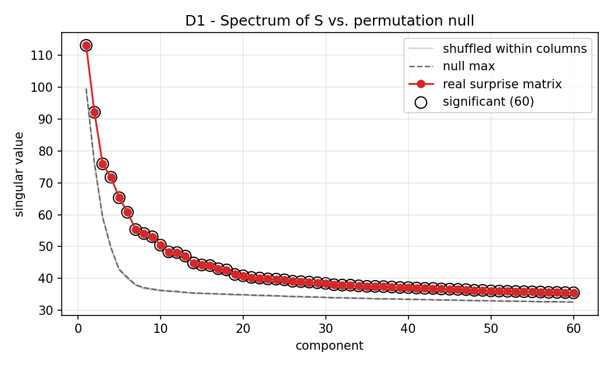
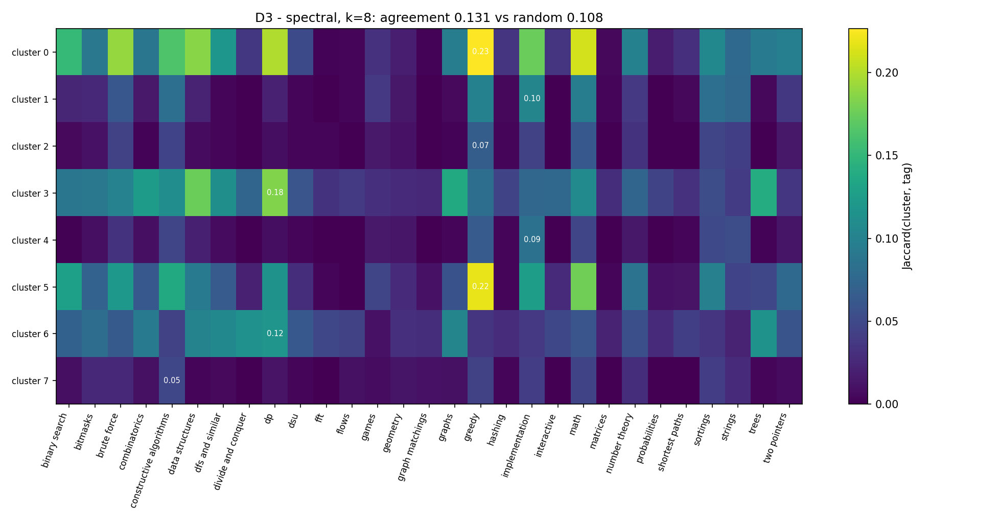
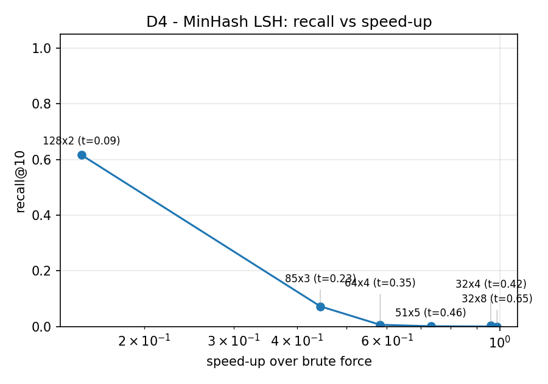

# Is One Number Enough? Searching for Hidden Skill Dimensions in Codeforces Ratings

Vishnu Sinha & Bhavay Goyal — CS 328

> Draft with the real numbers from the full run (589 rounds, 10 Nov 2026).
> Everything marked **[draft reading]** is our interpretation and should be
> checked / rewritten in our own words before submission. All numbers come from
> files in `outputs/`; the file is named next to each one.

## 1. Question

Codeforces compresses a contestant into one rating. Once rating is accounted for,
is there consistent structure in who solves what? If yes: what are the axes, do
they match the hand-assigned tags, and who are a user's skill twins?

## 2. Data

* Source: public Codeforces API (`problemset.problems`, `contest.standings`,
  `contest.ratingChanges`). No scraping. 1,187 API calls at 1 call / 2 s.
* Rounds: 600 most recent finished individual rounds (Div. 1–4, Educational,
  Global; Codeforces Round 706 … Round 1116), each ≥ 90 days old so problem
  ratings are settled. 11 were unrated and skipped → **589 rounds**
  (`data/raw/manifest.json`).
* Users: **36,519** with ≥ 40 rated participations (out of 455,111 rated
  participants). Median 57 rounds per user; median last rating 1420
  (IQR 1228–1623); max 3792.
* Problems: **3,773** with a settled difficulty rating.
* Surprise matrix S: 36,519 × 3,773, **15.85 M** observed entries (density 0.115).
  Mean surprise +0.029 (Elo is slightly pessimistic for these regular users),
  std 0.259; 39.1 % of observed pairs were solved.

## 3. Method

* Surprise `s_ij = y_ij − p_ij`, Elo `p_ij = 1/(1+10^((r_j−R_i)/400))`. Unobserved = 0.
* **D1**: truncated SVD (k = 20, and k = 60) vs. 20 (10 for k = 60) column-wise
  permutation nulls: observed surprises are shuffled within each problem column,
  keeping every problem's surprise distribution and the exact sparsity pattern
  but destroying user-level consistency. Component k is significant if σ_k is
  larger than the k-th singular value of *every* null copy.
* Robustness: the same test after subtracting each user's mean surprise in each
  round (`--residualize-contest`), which removes "good day / bad day" and
  "form" effects shared by all problems of a round.
* **D2**: top/bottom-loading problems per axis + tag enrichment (z-score of mean
  loading, tagged vs. untagged) + correlation of loading with problem rating.
* **D3**: k-means / spectral clustering of problems on `V Σ`; cluster × tag
  Jaccard; agreement = mean best-match Jaccard vs. random partitions with the
  same sizes.
* **D4**: MinHash (256 hashes) + banding; recall@10 vs. brute force on 3,000 users
  for several (b, r); full-population run (35,811 users) timed against a chunked
  exact baseline.
* **D5**: `python -m cfskills.demo <handle>`.

## 4. Results

### D1 — Is there anything beyond rating? **Yes.**

`outputs/D1_spectrum_k60.csv`:

| component | σ (real) | σ (null max) | ratio |
|---|---|---|---|
| 1 | 113.1 | 99.6 | 1.14 |
| 2 | 92.2 | 76.2 | 1.21 |
| 3 | 76.0 | 59.2 | 1.28 |
| 4 | 71.8 | 49.7 | 1.44 |
| 5 | 65.3 | 42.9 | **1.52** |
| 6 | 60.8 | 40.4 | 1.51 |
| 7–9 | 55.3–53.1 | 38.0–36.7 | 1.46 |
| 10 | 50.5 | 36.3 | 1.39 |
| 20 | 40.8 | 34.9 | 1.17 |
| 60 | 35.5 | 32.6 | 1.09 |

* All 60 components beat every shuffled copy; the real spectrum never falls into
  the null. The gap is largest for components 4–9 and shrinks slowly afterwards.
* After residualizing per user × round (`D1_spectrum_resid.csv`) the result is
  the same: 20/20 significant, ratios 1.24, 1.34, 1.49, 1.65, 1.67, 1.66, … —
  i.e. the structure is **not** explained by users having good and bad days.

**[draft reading]** A single number is not enough: who solves what, given
rating, is strongly non-random. But "60 significant components" does not mean 60
skills — with 16 M observations the test has enormous power and picks up weak
but consistent effects. The useful content is in the first ~10 components.

### D2 — What are the hidden skills?

`outputs/D2_axes.md`, `outputs/D2_axis_summary.csv`. Recurring pattern across
axes (sign is arbitrary):

| axis | σ | corr(loading, rating) | `+` end enriched | `−` end enriched |
|---|---|---|---|---|
| 1 | 113 | **−0.47** | implementation (z=+5.8), strings, greedy; mean rating 840 | dfs (z=−22.6), trees, divide & conquer, dp, graphs; mean rating 1200 |
| 2 | 92 | 0.01 | implementation, combinatorics, data structures | constructive, greedy, math |
| 3 | 76 | 0.14 | dp (+6.7), combinatorics, trees, graphs | math, games, strings |
| 4 | 72 | −0.17 | greedy (+9.0), constructive, binary search | meet-in-the-middle, suffix structures, trees, fft |
| 5 | 65 | 0.09 | meet-in-the-middle, probabilities, graphs | greedy, games, math |
| 8 | 54 | −0.11 | math (+7.6), constructive, geometry, number theory | data structures (−8.4), trees, binary search, dfs |
| 9 | 53 | 0.16 | meet-in-the-middle, trees, divide & conquer | constructive, math, greedy |
| 11 | 48 | 0.00 | dp, data structures, binary search | constructive, games, greedy |
| 12 | 48 | −0.05 | constructive, greedy | combinatorics, binary search, math |

**[draft reading]**

* **Axis 1 is mostly difficulty / "solving above your weight".** Its `+` end is
  the easy Div. 3/4 A–B problems (800–1100) and its `−` end is hard graph/DP/tree
  problems; loading correlates −0.47 with rating. Users at the `−` end (tourist
  and jiangly are at the 12th percentile) are those who over-perform on hard
  algorithmic problems; users at the `+` end are those who reliably clean up
  easy problems. This is real structure beyond rating but it is closer to
  "form"/under-rating than to a topic.
* **The dominant topical contrast is "ad-hoc" vs. "algorithmic":** constructive /
  greedy / math on one side, dp / data structures / trees / graphs / binary
  search on the other. It appears on axes 2, 3, 4, 8, 11, 12, 15 with low
  rating correlation (|corr| ≤ 0.17), so it is not difficulty in disguise.
  Axis 8 is the cleanest example (math z=+7.6 vs. data structures z=−8.4,
  corr with rating −0.11, both ends ≈ 1230 rated).
* A secondary contrast is **heavy algorithms** (meet-in-the-middle, suffix
  structures, fft, flows, probabilities) vs. **greedy/implementation** (axes 4,
  5, 6, 9, 10) — partly a Div. 1 vs. Div. 2 pool effect, since only strong users
  face those problems.
* The residualized run (`D2_axes_resid.md`) shows the same contrasts (axis 2:
  combinatorics/dp/data structures vs. constructive; axes 4–5: trees/dp/graphs
  vs. greedy/constructive/sortings), so they survive removing round-level form.

### D3 — Do the tags capture them? **Only weakly.**

`outputs/D3_agreement*.json`, `outputs/D3_agreement_by_k*.csv` (problems with
≥ 1,000 observing users, 3,326 of 3,773):

| setting | agreement | random (mean ± sd) | z | p |
|---|---|---|---|---|
| k-means, k = 8 | 0.097 | 0.094 ± 0.001 | 2.5 | 0.015 |
| spectral, k = 8 | 0.131 | 0.108 ± 0.001 | 17.7 | < 0.01 |
| k-means, k = 2 (silhouette pick) | 0.268 | 0.258 ± 0.002 | 5.0 | < 0.01 |
| k-means, all k in 2…12 | within +0.000 … +0.010 of random | | 0.3–5.6 | |

* Agreement is statistically above random for most settings, but the *effect
  size* is tiny: clusters match their best tag only 1–2 Jaccard points better
  than random partitions of the same sizes.
* The clusters that k-means does find are organised by **difficulty / division**,
  not by topic: for k = 8 one cluster holds 2,130 problems with mean rating 2035,
  the other seven are 800–1400-rated Div. 3/4 problems split by position in
  the round (`D3_agreement.json`, `mean_rating` and `most_common_tags`).
* Same picture on the residualized SVD (`D3_agreement_resid*.json`:
  k-means 0.103 vs 0.099, spectral 0.123 vs 0.118).

**[draft reading]** Tags are enriched at the ends of several axes (D2), so they
are *related* to the hidden dimensions, but they do not *partition* problems the
way users' behaviour does. "dp" or "greedy" is not a clean skill unit in the
data; the data-driven grouping is dominated by how hard the problem is and which
division it was set for.

### D4 — LSH evaluation

* Tokens: `hit:j` if solved with p < 0.3, `miss:j` if missed with p > 0.7
  (|s| > 0.7). 35,811 users have ≥ 5 tokens; **median 15 tokens per user**,
  6,025 distinct tokens (`D4_neighbour_stats.json`).
* Important empirical fact: **nearest neighbours are far apart.** On a 3,000-user
  sample the exact top-1 Jaccard has median 0.119 (90th pct 0.171) and the
  10-th neighbour has median 0.071. So the proposal's 32 × 4 banding (threshold
  ≈ 0.42) finds almost nothing — a correct LSH, but tuned for a similarity level
  that does not exist in this data. We therefore swept low thresholds with 256
  hashes (`D4_lsh_eval.csv`):

| bands × rows | threshold | candidate fraction | recall@10 (sample) |
|---|---|---|---|
| 128 × 2 | 0.088 | 1.4 % | **0.617** |
| 85 × 3 | 0.227 | 0.07 % | 0.073 |
| 64 × 4 | 0.354 | 0.002 % | 0.006 |
| 51 × 5 | 0.455 | ~0 | 0.001 |
| 32 × 8 | 0.648 | 0 | 0 |

* Full population with 128 × 2 (`D4_full_run.json`): 8.9 M candidate pairs =
  **1.39 % of all 641 M pairs**, exact **recall@10 = 0.839** against the chunked
  brute force. Recall is higher than on the sample because with 36k users the
  true neighbours are closer and more often share a band.
* Wall clock: LSH 42.6 s vs. brute force 11.9 s (speed-up 0.28×). Honest
  statement: with sets this small, a sparse matrix product in BLAS is already
  very fast and our Python banding/`np.unique` over 8.9 M pairs costs more than
  the 99 % of pair comparisons it saves. The algorithmic saving (1.4 % of pairs
  examined at 84 % recall) is real; the constant factors are not in LSH's favour
  at n = 36k.

### D5 — Demo

`python -m cfskills.demo tourist jiangly` (axes 1–8):

* tourist (3439) and jiangly (3728): axis 1 at the 12th–13th percentile (the
  "solves hard algorithmic problems above expectation" end), near the median on
  every other axis; each other's top twin (J = 0.216), then Radewoosh, ksun48,
  maroonrk, Benq, Um_nik.
* TODO: pick 2–3 users around 1600 with different fingerprints
  (`users.csv` has 300+-round users at 1590–1645: at2c, AHMADUL, amirhozaifa,
  Sabbir.Hasan) and show them side by side; screenshot the Streamlit app.
* Caveat for the report: twins are necessarily rating-neighbours, because two
  users can only share hit/miss tokens on problems they both faced, i.e. in the
  same division.

## 5. Discussion and limitations

* **Answer to the north star:** no, one number is not enough — the surprise
  matrix has structure that no within-problem shuffle reproduces, and it
  survives removing per-round form. But most of that structure is (i) how a user
  performs on easy vs. hard problems relative to rating and (ii) an ad-hoc/math
  vs. algorithmic/data-structure contrast; it does not line up with the tag
  taxonomy.
* Zero-filling unobserved pairs biases towards *no* structure (so D1 is
  conservative in that respect) but also lets "which division you compete in"
  leak into the axes (axes 4–6, 9–10).
* The permutation null keeps each problem's distribution but destroys *all*
  user-level dependence, so any consistent per-user effect counts as signal;
  with 16 M entries even weak effects are significant. Effect sizes (ratios,
  tag-enrichment z, Jaccard gaps) matter more than the count of significant
  components.
* Problem ratings are estimated from solve data (mild circularity).
* Div. 3/4 and Educational rounds are rated only for lower-rated users; most
  observed entries come from these rounds, so the axes are dominated by
  800–1400-rated problems.
* In-contest solves only; same time pressure for every surprise. Speed of
  implementation is probably a large part of axis 1.
* Tag Jaccard is a harsh metric for multi-tag problems; an alternative (e.g.
  normalised mutual information between clusters and the dominant tag) could be
  added if time permits.

## 6. Contributions

* Vishnu: API pull, surprise matrix, SVD + null test, D1–D2.
* Bhavay: MinHash LSH, evaluation, demo, D4–D5.
* Shared: clustering, tag comparison (D3), report.
